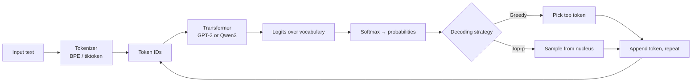

# LLM Playground: From Tokens to Text Generation

A hands-on exploration of how large language models work under the hood: how text becomes tokens, how a transformer turns tokens into next-token probabilities, and how decoding strategies turn those probabilities into text. It ends with a side-by-side comparison of a 2019 base model (GPT-2) and a 2025 instruction-tuned reasoning model (Qwen3-0.6B), plus a small interactive playground.

**Stack:** Python · PyTorch · Hugging Face Transformers · tiktoken · ipywidgets

## What's inside

| Section | What I built | What it shows |
|---|---|---|
| 1. Tokenization | Word-level and character-level tokenizers from scratch; GPT-2 BPE; tiktoken encodings | Why modern models use subword tokenization |
| 2. Language models | Loaded GPT-2, inspected its architecture, counted parameters, computed next-token probabilities | A language model is a next-token probability function |
| 3. Decoding | Greedy and top-p (nucleus) sampling wrappers around `generate()` | How decoding choices change output quality |
| 4. Modern LLMs | GPT-2 vs Qwen3-0.6B on the same prompts, using chat templates | What instruction tuning and reasoning add |
| 5. Playground | Interactive widget UI: model, decoding strategy, temperature | A quick way to build intuition by experimenting |

## How it works



## Key findings

**Tokenization trade-offs**
- **Word-level** (24-word vocabulary from a small corpus): any unseen word becomes `[UNK]`. `"it works only on text"` decodes as `"it works [UNK] on text"`, losing information.
- **Character-level** (87 tokens): no unknown words, but sequences get very long and each token carries little meaning.
- **Subword BPE** (GPT-2, 50,257 tokens) is the middle ground: `"Unbelievable"` → `Un · bel · iev · able`. Rare words decompose into known pieces, and common words stay whole.
- **Newer encodings are more efficient.** The same sentence takes 12 tokens with `cl100k_base` (GPT-4) and 11 with `o200k_base` (GPT-4o), which has a 200K vocabulary. Fewer tokens means lower cost and more usable context.

**Inside GPT-2**
- GPT-2 Small has **124,439,808 parameters** across 12 transformer blocks.
- Given `"Hello my name"`, it predicts `" is"` with **77.7%** probability. The whole model reduces to this next-token distribution.

**Decoding matters as much as the model**
- **Greedy decoding** falls into repetition loops quickly (*"The world was a place of great danger, and the world was a place of great danger…"*).
- **Top-p sampling** (p = 0.9, T = 0.9) produces varied, more natural continuations, at the cost of determinism.

**Base vs instruction-tuned models**
- Asked *"What is 2+2?"*, **GPT-2** simply continues the text as if writing a blog post.
- **Qwen3-0.6B** is given the prompt through its chat template. It reasons inside `<think>…</think>` tokens and then answers the question. The chat template matters: without it, even an instruction-tuned model behaves like a plain text completer.

## Design decisions

- **Hugging Face `generate()` instead of a hand-written loop.** I implemented next-token prediction manually once (softmax + top-k) to understand it, then used `generate()` for decoding. It handles stopping, padding, and sampling parameters consistently across models.
- **One `generate()` helper with a `strategy` parameter** (greedy / top-p), so models and strategies can be compared on identical prompts without duplicated code.
- **Device selection** picks CUDA, falling back to Apple Silicon (MPS), so the notebook runs on a laptop GPU.
- **Small models on purpose.** GPT-2 (124M) and Qwen3-0.6B run locally with no API keys, which keeps every experiment reproducible and free.

## Run it

```bash
# Option 1: conda
conda env create -f environment.yaml && conda activate llm_playground

# Option 2: uv
uv venv && source .venv/bin/activate && uv pip install -r requirements.txt

jupyter lab llm_playground.ipynb
```

The first run downloads GPT-2 (~500 MB) and Qwen3-0.6B (~1.5 GB) from Hugging Face.

## Acknowledgments

Built as part of the [ByteByteGo](https://bytebytego.com/) AI Engineering course. The course provided the project outline; the implementation and analysis are my own.
